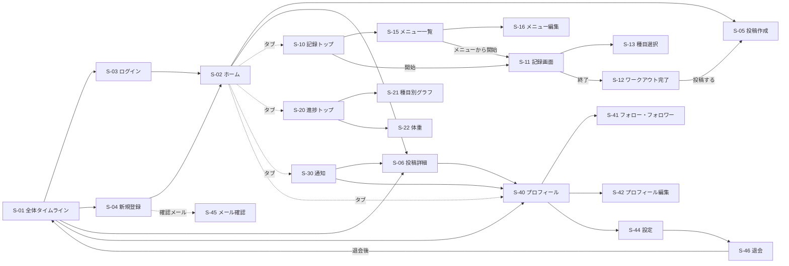

# 画面一覧と画面遷移

[目次に戻る](README.md)

スマートフォンでは画面下部にタブ（ホーム／記録／進捗／通知／プロフィール）を、PC では左側にナビゲーションを表示する。記録中のワークアウトがあるときは、どの画面でもタブの上に「記録中（経過時間）」のバーを表示し、タップで記録画面に戻れる。

| ID | 画面 | パス | ログイン | 概要 | 主な機能 |
| --- | --- | --- | --- | --- | --- |
| S-01 | 全体タイムライン | `/explore` | 不要 | 全ユーザーの投稿。未ログイン時のトップ（`/` から転送する） | F-56 |
| S-02 | ホームタイムライン | `/` | 必要 | 自分とフォロー中のユーザーの投稿 | F-55, F-57, F-85 |
| S-03 | ログイン | `/login` | 不要 | メール＋パスワード | F-03 |
| S-04 | 新規登録 | `/signup` | 不要 | 登録フォーム、規約への同意 | F-01 |
| S-05 | 投稿作成 | （モーダル） | 必要 | 本文、画像 4 枚まで、ワークアウトの添付 | F-50〜F-52 |
| S-06 | 投稿詳細 | `/posts/[id]` | 不要 | 本文、画像、添付ワークアウト、コメント | F-53, F-54, F-60〜F-63 |
| S-10 | 記録トップ | `/workouts` | 必要 | 「空のワークアウトを開始」「メニューから開始」、カレンダー、履歴リスト | F-15, F-17, F-21 |
| S-11 | 記録画面 | `/workouts/current` | 必要 | 種目・セットの入力、休憩タイマー、PR バッジ、終了ボタン | F-12〜F-14, F-16, F-22, F-33 |
| S-12 | ワークアウト完了 | `/workouts/summary?id=…` | 必要 | 総ボリューム・時間・更新した自己ベストの表示、「投稿する」 | F-33, F-52 |
| S-13 | 種目選択 | （モーダル） | 必要 | 部位で絞り込み、名前で検索、自分の種目の追加 | F-10, F-11 |
| S-14 | 種目の管理 | `/exercises` | 必要 | 自分の種目の一覧・編集・非表示 | F-11 |
| S-15 | メニュー一覧 | `/routines` | 必要 | メニューの一覧、作成 | F-20, F-24 |
| S-16 | メニュー編集 | `/routines/[id]` | 必要 | 種目・目標値・休憩秒数・並び順 | F-20 |
| S-17 | タイマー | `/timer` | 必要 | 単体のインターバルタイマー | F-23 |
| S-20 | 進捗トップ | `/progress` | 必要 | 週間サマリー、自己ベスト一覧、体重の最新値 | F-32, F-34 |
| S-21 | 種目別グラフ | `/progress/exercises/[id]` | 必要 | 最大重量・推定 1RM・ボリュームの推移、その種目の自己ベスト | F-30, F-31 |
| S-22 | 体重 | `/progress/body` | 必要 | 体重・体脂肪率の入力と推移グラフ | F-40〜F-42 |
| S-30 | 通知 | `/notifications` | 必要 | 通知一覧 | F-80, F-81 |
| S-40 | プロフィール | `/users/[handle]` | 不要 | 投稿一覧、フォロー数・フォロワー数、実績 | F-70, F-72 |
| S-41 | フォロー・フォロワー一覧 | `/users/[handle]/following` `/users/[handle]/followers` | 不要 | | F-73 |
| S-42 | プロフィール編集 | `/settings/profile` | 必要 | アイコン、表示名、自己紹介 | F-71 |
| S-43 | ユーザー検索 | `/search?q=` | 不要 | ユーザーID・表示名で検索 | F-74 |
| S-44 | 設定 | `/settings` | 必要 | プロフィール編集・退会への導線、画面スリープ防止の切り替え、ログアウト | F-03 |
| S-45 | メール確認 | `/verify-email?token=` | 不要 | 確認リンクの着地ページ。開いただけでは確認せず、「メールアドレスを確認する」ボタンで確定する（メールのセキュリティ機能がリンクを先に開いても、トークンを使い切らないように）。成功・期限切れ・使用済み・無効なリンクを表示し、期限切れなら再送できる | F-02 |
| S-46 | 退会 | `/settings/account` | 必要 | 削除されるデータの説明、パスワードの再入力、退会の実行 | F-06 |

メールアドレスが未確認のユーザーには、すべての画面の上部に「メールアドレスを確認してください」の帯と「確認メールを再送」ボタンを表示する（F-02）。未確認のまま投稿・いいね・コメント・フォローのボタンを押した場合も、同じ案内を表示する。

