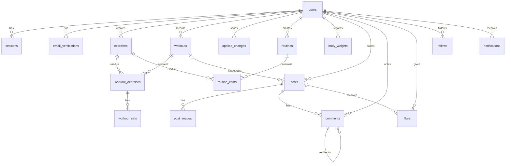

# データモデル

[目次に戻る](README.md)

## 論理名と物理名

この文書では、テーブルと項目を**論理名（日本語）**と**物理名（英語）**で併記する。

- **論理名**：文書や会話で使う、意味の分かる名前（例：実施日）
- **物理名**：DB・プログラムの中で実際に使う名前（例：`performed_on`）

物理名を英語にしている理由は次のとおり。

1. **コードにそのまま書く名前だから**：物理名は SQL、Prisma のスキーマ、TypeScript のコードにそのまま出てくる。日本語の名前も技術的には不可能ではないが、SQL では毎回引用符で囲む必要があり、ツールやライブラリによっては扱えないこともあるため、英数字で付けるのが一般的な慣習になっている
2. **英語の名前から型や関数名が作られるから**：Prisma はテーブル `workouts` から `Workout` 型を生成する。コード中の変数名（`workout.performedOn`）とそろうので、読み違いが起きにくい
3. **列挙値も同じ理由**：`CHEST` や `LIKE` は DB に保存される値そのもの。画面に出すときは「胸」「いいね」のように日本語に変換する（[列挙値の対応表](#列挙値の対応表)）

## 方針

- DB は MySQL 8.4。文字コードは `utf8mb4`、照合順序は大文字小文字を区別しないもの（`_ci`）にする。データベースの既定は `utf8mb4_0900_ai_ci`、Prisma が作るテーブルは `utf8mb4_unicode_ci` になるが、どちらも大文字小文字を区別しない
- スキーマは Prisma（`prisma/schema.prisma`）で定義し、マイグレーションも Prisma で管理する。物理名は snake_case にする（Prisma のモデル名は PascalCase にし、`@@map` / `@map` で対応させる）
- ID はアプリ側で生成する UUIDv7 にする（作成順に並ぶので、カーソル方式のページングにそのまま使える）。格納形式は `CHAR(36)`（ハイフン付きの文字列）にする。DB を直接見ても読めること、Prisma で変換なしに扱えること、数十人規模なら容量の差が問題にならないことから選んだ
- 圏外でも記録できるよう（F-16）、ワークアウト・ワークアウトの種目・セットの ID は**端末で生成**し、サーバーはその ID のまま保存する。それ以外の ID はサーバーで生成する
- 日時は `DATETIME(3)` で UTC に統一する。実施日・測定日のような「日付」は、日本時間の日付を `DATE` で持つ
- 重量は `DECIMAL(6,2)`、体重は `DECIMAL(5,1)` にし、浮動小数点型は使わない
- 列挙値は MySQL の `ENUM` 型を使わず、`VARCHAR` に入れる。値は Prisma の enum とアプリ側の検証で縛る（値を追加するときに、テーブルを作り直さずに済むようにするため）
- 外部キーを張る。ユーザーの削除（退会、F-06）では、そのユーザーのデータを連鎖削除する。例外として、返信が付いたコメントは投稿者を NULL にして残す

表の「必須」列：○＝必須（NOT NULL）、空欄＝NULL を許す。

## ER 図

図のエンティティ名は物理名で書いている（Mermaid の ER 図は日本語の名前を正しく表示できない場合があるため）。

| 論理名 | 物理名 | 分類 |
| --- | --- | --- |
| ユーザー | users | ユーザー・認証 |
| セッション | sessions | ユーザー・認証 |
| メールアドレス確認 | email_verifications | ユーザー・認証 |
| 種目 | exercises | トレーニング |
| ワークアウト | workouts | トレーニング |
| ワークアウトの種目 | workout_exercises | トレーニング |
| セット | workout_sets | トレーニング |
| 反映済みの変更 | applied_changes | トレーニング |
| メニュー | routines | トレーニング |
| メニューの項目 | routine_items | トレーニング |
| 体重記録 | body_weights | 体重 |
| 投稿 | posts | SNS |
| 投稿画像 | post_images | SNS |
| コメント | comments | SNS |
| いいね | likes | SNS |
| フォロー | follows | SNS |
| 通知 | notifications | SNS |

## ユーザー・認証

### ユーザー（users）

| 論理名 | 物理名 | 型 | 必須 | 説明 |
| --- | --- | --- | --- | --- |
| ID | id | CHAR(36) | ○ | UUIDv7 |
| メールアドレス | email | VARCHAR(254) | ○ | |
| パスワードハッシュ | password_hash | VARCHAR(100) | ○ | bcrypt のハッシュ値 |
| メール確認日時 | email_verified_at | DATETIME(3) | | NULL ならメールアドレス未確認（F-02） |
| ユーザーID | handle | VARCHAR(15) | ○ | 「@」の後ろに表示する ID。英数字と `_`、3〜15 文字 |
| 表示名 | display_name | VARCHAR(50) | ○ | |
| 自己紹介 | bio | VARCHAR(160) | ○ | 既定値は空文字 |
| アイコン画像のキー | avatar_key | VARCHAR(255) | | S3 上のファイルの場所 |
| 目標体重 | target_weight_kg | DECIMAL(5,1) | | 未設定なら NULL（F-42） |
| 画面スリープ防止 | keep_screen_awake | BOOLEAN | ○ | 記録中に画面を消さない設定。既定値は true |
| 作成日時 | created_at | DATETIME(3) | ○ | |

- メールアドレス・ユーザーIDは一意（照合順序により大文字小文字を区別しない）

### セッション（sessions）

| 論理名 | 物理名 | 型 | 必須 | 説明 |
| --- | --- | --- | --- | --- |
| ID | id | CHAR(36) | ○ | |
| トークンのハッシュ | token_hash | CHAR(64) | ○ | Cookie に入れるトークンの SHA-256。トークンそのものは保存しない |
| ユーザーID | user_id | CHAR(36) | ○ | → users |
| 有効期限 | expires_at | DATETIME(3) | ○ | ログインから 30 日 |
| 作成日時 | created_at | DATETIME(3) | ○ | |

- トークンのハッシュは一意。ユーザーIDにインデックス

### メールアドレス確認（email_verifications）

| 論理名 | 物理名 | 型 | 必須 | 説明 |
| --- | --- | --- | --- | --- |
| ID | id | CHAR(36) | ○ | |
| ユーザーID | user_id | CHAR(36) | ○ | → users |
| トークンのハッシュ | token_hash | CHAR(64) | ○ | 確認リンクのトークンの SHA-256。トークンそのものは保存しない |
| 有効期限 | expires_at | DATETIME(3) | ○ | 発行から 24 時間 |
| 使用日時 | used_at | DATETIME(3) | | 確認に使われたら記録し、以後は無効 |
| 作成日時 | created_at | DATETIME(3) | ○ | 再送の間隔（1 分）の確認に使う |

- トークンのハッシュは一意。ユーザーIDにインデックス

## トレーニング

### 種目（exercises）

| 論理名 | 物理名 | 型 | 必須 | 説明 |
| --- | --- | --- | --- | --- |
| ID | id | CHAR(36) | ○ | |
| 作成者 | user_id | CHAR(36) | | → users。NULL ならプリセット（全員が使える種目） |
| 種目名 | name | VARCHAR(30) | ○ | |
| 部位 | body_part | VARCHAR(20) | ○ | [列挙値](#列挙値の対応表) |
| 種別 | kind | VARCHAR(20) | ○ | 重量・自重・時間・有酸素（[列挙値](#列挙値の対応表)） |
| 非表示日時 | hidden_at | DATETIME(3) | | 記録で使用中の種目は削除せず、非表示にする（F-11） |
| 作成日時 | created_at | DATETIME(3) | ○ | |

- (作成者, 種目名) で一意。プリセットはシード（初期データ）で投入する

### ワークアウト（workouts）

1 回のトレーニングを表す。

| 論理名 | 物理名 | 型 | 必須 | 説明 |
| --- | --- | --- | --- | --- |
| ID | id | CHAR(36) | ○ | |
| ユーザーID | user_id | CHAR(36) | ○ | → users |
| 実施日 | performed_on | DATE | ○ | 日本時間の日付 |
| 開始日時 | started_at | DATETIME(3) | ○ | |
| 終了日時 | finished_at | DATETIME(3) | | NULL なら記録中 |
| メモ | note | VARCHAR(500) | ○ | 既定値は空文字 |
| 作成日時 | created_at | DATETIME(3) | ○ | |
| 端末での更新日時 | client_updated_at | DATETIME(3) | ○ | 端末で最後に変更した時刻。複数の端末で変えたとき、新しいほうを採用する判定に使う |

- (ユーザーID, 実施日) にインデックス（カレンダー・履歴・集計用）
- 記録中のワークアウトは 1 ユーザーにつき 1 件まで（アプリ側で確認する）

### ワークアウトの種目（workout_exercises）

ワークアウトの中で行った種目と、その並び順を表す。

| 論理名 | 物理名 | 型 | 必須 | 説明 |
| --- | --- | --- | --- | --- |
| ID | id | CHAR(36) | ○ | |
| ワークアウトID | workout_id | CHAR(36) | ○ | → workouts |
| 種目ID | exercise_id | CHAR(36) | ○ | → exercises |
| 並び順 | sort_order | SMALLINT | ○ | |
| 休憩秒数 | rest_seconds | SMALLINT | ○ | インターバルタイマーの秒数。既定値は 90 |
| 端末での更新日時 | client_updated_at | DATETIME(3) | ○ | workouts と同じ |

- (ワークアウトID, 並び順) で一意。種目IDにインデックス（集計用）。同じ種目を複数回並べてもよい

### セット（workout_sets）

| 論理名 | 物理名 | 型 | 必須 | 説明 |
| --- | --- | --- | --- | --- |
| ID | id | CHAR(36) | ○ | |
| ワークアウトの種目ID | workout_exercise_id | CHAR(36) | ○ | → workout_exercises |
| 並び順 | sort_order | SMALLINT | ○ | 1 セット目、2 セット目… |
| 重量（kg） | weight_kg | DECIMAL(6,2) | | 重量種目。自重・時間種目では加重分 |
| 回数 | reps | SMALLINT | | 重量・自重種目 |
| 時間（秒） | duration_seconds | INT | | 時間種目・有酸素 |
| 距離（m） | distance_m | INT | | 有酸素（任意） |
| 完了日時 | completed_at | DATETIME(3) | | 「完了」にした日時。NULL なら未完了 |
| 作成日時 | created_at | DATETIME(3) | ○ | |
| 端末での更新日時 | client_updated_at | DATETIME(3) | ○ | workouts と同じ |

- (ワークアウトの種目ID, 並び順) で一意。種別ごとにどの項目が必須かは、アプリ側で検証する

### 反映済みの変更（applied_changes）

端末から送られた変更（[記録中のデータの同期](06_api.md#記録中のデータの同期)）のうち、反映済みのものを覚えておき、同じ変更が二重に送られても 2 回反映しないようにする。

| 論理名 | 物理名 | 型 | 必須 | 説明 |
| --- | --- | --- | --- | --- |
| 変更ID | change_id | CHAR(36) | ○ | 主キー。端末で生成する |
| ユーザーID | user_id | CHAR(36) | ○ | → users |
| 反映日時 | applied_at | DATETIME(3) | ○ | 7 日たったものは定期的に削除する |

### メニュー（routines）

| 論理名 | 物理名 | 型 | 必須 | 説明 |
| --- | --- | --- | --- | --- |
| ID | id | CHAR(36) | ○ | |
| ユーザーID | user_id | CHAR(36) | ○ | → users |
| メニュー名 | name | VARCHAR(30) | ○ | |
| 作成日時 | created_at | DATETIME(3) | ○ | |
| 更新日時 | updated_at | DATETIME(3) | ○ | |

### メニューの項目（routine_items）

| 論理名 | 物理名 | 型 | 必須 | 説明 |
| --- | --- | --- | --- | --- |
| ID | id | CHAR(36) | ○ | |
| メニューID | routine_id | CHAR(36) | ○ | → routines |
| 種目ID | exercise_id | CHAR(36) | ○ | → exercises |
| 並び順 | sort_order | SMALLINT | ○ | |
| 目標セット数 | target_sets | SMALLINT | ○ | |
| 目標回数 | target_reps | SMALLINT | | 有酸素では NULL |
| 目標重量（kg） | target_weight_kg | DECIMAL(6,2) | | |
| 休憩秒数 | rest_seconds | SMALLINT | ○ | 既定値は 90 |

- (メニューID, 並び順) で一意。1 メニューにつき 20 件まで

自己ベスト・グラフ・週間サマリーは、セットをワークアウト・ワークアウトの種目と結合して、その都度集計する（集計結果のテーブルは持たない）。性能が足りなくなったら、集計テーブルの追加を検討する。

## 体重

### 体重記録（body_weights）

| 論理名 | 物理名 | 型 | 必須 | 説明 |
| --- | --- | --- | --- | --- |
| ID | id | CHAR(36) | ○ | |
| ユーザーID | user_id | CHAR(36) | ○ | → users |
| 測定日 | measured_on | DATE | ○ | 日本時間の日付 |
| 体重（kg） | weight_kg | DECIMAL(5,1) | ○ | |
| 体脂肪率（%） | body_fat_pct | DECIMAL(4,1) | | |
| 作成日時 | created_at | DATETIME(3) | ○ | |
| 更新日時 | updated_at | DATETIME(3) | ○ | |

- (ユーザーID, 測定日) で一意（同じ日に記録すると上書き）

## SNS

### 投稿（posts）

| 論理名 | 物理名 | 型 | 必須 | 説明 |
| --- | --- | --- | --- | --- |
| ID | id | CHAR(36) | ○ | |
| ユーザーID | user_id | CHAR(36) | ○ | → users |
| 本文 | body | VARCHAR(280) | ○ | 画像かワークアウトがあれば空文字でもよい |
| 添付ワークアウトID | workout_id | CHAR(36) | | → workouts。ワークアウトが削除されたら NULL にする |
| 作成日時 | created_at | DATETIME(3) | ○ | |

- (ユーザーID, 作成日時)・(作成日時) にインデックス（タイムライン用）

### 投稿画像（post_images）

| 論理名 | 物理名 | 型 | 必須 | 説明 |
| --- | --- | --- | --- | --- |
| ID | id | CHAR(36) | ○ | |
| 投稿ID | post_id | CHAR(36) | | → posts。アップロード直後で、まだ投稿に使われていない間は NULL |
| 作成者 | user_id | CHAR(36) | ○ | → users。投稿前の画像の持ち主の確認に使う |
| 表示用画像のキー | original_key | VARCHAR(255) | ○ | S3 上の場所（長辺 2048px） |
| サムネイルのキー | thumbnail_key | VARCHAR(255) | ○ | S3 上の場所（長辺 640px） |
| 幅 | width | INT | ○ | ピクセル |
| 高さ | height | INT | ○ | ピクセル |
| 並び順 | sort_order | SMALLINT | ○ | 0〜3 |
| 作成日時 | created_at | DATETIME(3) | ○ | 投稿に使われないまま 24 時間たった画像の削除に使う |

- (投稿ID, 並び順) で一意

### コメント（comments）

| 論理名 | 物理名 | 型 | 必須 | 説明 |
| --- | --- | --- | --- | --- |
| ID | id | CHAR(36) | ○ | |
| 投稿ID | post_id | CHAR(36) | ○ | → posts |
| 投稿者 | user_id | CHAR(36) | | → users。退会したら NULL（「削除されたユーザー」と表示） |
| 返信先コメントID | parent_id | CHAR(36) | | → comments。返信の場合だけ。返信先は最上位のコメントに限る |
| 返信先ユーザーID | reply_to_user_id | CHAR(36) | | → users。返信への返信のとき「@ユーザー」を表示するため |
| 本文 | body | VARCHAR(280) | ○ | |
| 削除日時 | deleted_at | DATETIME(3) | | 返信が付いたコメントを削除したとき（論理削除） |
| 作成日時 | created_at | DATETIME(3) | ○ | |

- (投稿ID, 作成日時)・(返信先コメントID) にインデックス

### いいね（likes）

| 論理名 | 物理名 | 型 | 必須 | 説明 |
| --- | --- | --- | --- | --- |
| ユーザーID | user_id | CHAR(36) | ○ | → users |
| 投稿ID | post_id | CHAR(36) | ○ | → posts |
| 作成日時 | created_at | DATETIME(3) | ○ | |

- 主キーは (ユーザーID, 投稿ID)。投稿IDにインデックス（いいね数の集計用）

### フォロー（follows）

| 論理名 | 物理名 | 型 | 必須 | 説明 |
| --- | --- | --- | --- | --- |
| フォローする人 | follower_id | CHAR(36) | ○ | → users |
| フォローされる人 | followee_id | CHAR(36) | ○ | → users |
| 作成日時 | created_at | DATETIME(3) | ○ | |

- 主キーは (フォローする人, フォローされる人)。フォローされる人にインデックス（フォロワー一覧用）
- 自分自身のフォローは、アプリ側で禁止する

### 通知（notifications）

| 論理名 | 物理名 | 型 | 必須 | 説明 |
| --- | --- | --- | --- | --- |
| ID | id | CHAR(36) | ○ | |
| 受け取る人 | recipient_id | CHAR(36) | ○ | → users |
| 操作した人 | actor_id | CHAR(36) | ○ | → users |
| 種類 | type | VARCHAR(10) | ○ | [列挙値](#列挙値の対応表) |
| 投稿ID | post_id | CHAR(36) | | → posts |
| コメントID | comment_id | CHAR(36) | | → comments |
| 既読日時 | read_at | DATETIME(3) | | NULL なら未読 |
| 作成日時 | created_at | DATETIME(3) | ○ | |

- (受け取る人, 作成日時)・(受け取る人, 既読日時) にインデックス（一覧・未読数用）

ユーザー検索（F-74）は、ユーザーIDと表示名の部分一致（`LIKE '%語%'`）で行う。利用者が少ないため MVP では全文検索インデックスは使わず、件数が増えたら MySQL の ngram パーサーによる FULLTEXT インデックスを検討する。

## 列挙値の対応表

### 部位（exercises.body_part）

| 値 | 意味 |
| --- | --- |
| CHEST | 胸 |
| BACK | 背中 |
| LEGS | 脚 |
| SHOULDERS | 肩 |
| ARMS | 腕 |
| ABS | 腹 |
| FULL_BODY | 全身 |
| CARDIO | 有酸素 |

### 種別（exercises.kind）

| 値 | 意味 | 記録する項目 |
| --- | --- | --- |
| WEIGHT | 重量 | 重量・回数 |
| BODYWEIGHT | 自重 | 回数（＋任意で加重） |
| TIMED | 時間 | 秒数（＋任意で加重）。プランクなど |
| CARDIO | 有酸素 | 時間・距離（任意） |

### 通知の種類（notifications.type）

| 値 | 意味 |
| --- | --- |
| LIKE | 自分の投稿にいいねされた |
| COMMENT | 自分の投稿にコメントされた |
| REPLY | 自分のコメントに返信された |
| FOLLOW | フォローされた |
