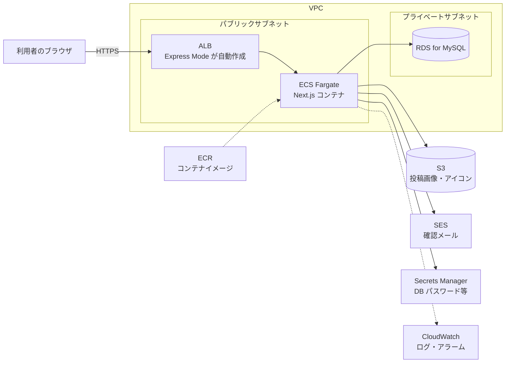

# AWS 構成

[目次に戻る](README.md)

Workout Log を AWS に公開するための構成。環境は動作確認・発表のときだけ作り、終わったら全部消す。

## 構成図

## なぜこの構成か

- **ECS Express Mode を使う**：当初は App Runner を予定していたが、App Runner は 2026-04-30 に新規利用者の受付を終了していた（[AWS 公式](https://docs.aws.amazon.com/ja_jp/apprunner/latest/dg/apprunner-availability-change.html)）。AWS が後継として勧める ECS Express Mode にした。コンテナイメージを指定するだけで、Fargate のサービス・ALB・HTTPS の URL・自動スケールを用意してくれる。Express Mode 自体の料金はかからず、Fargate と ALB などの利用料だけがかかる（[ECS Express Mode](https://docs.aws.amazon.com/ja_jp/AmazonECS/latest/developerguide/express-service-overview.html)）
- **SNSアプリとの違い**：SNSアプリは CloudFront＋S3（フロント）と、自分で組んだ ECS Fargate・ALB・NAT Gateway（API）の構成だった。このアプリは Next.js が画面と API を 1 つのコンテナで返すので、フロントを別に配信する CloudFront＋S3 は使わない。ALB などは Express Mode に任せる
- **NAT Gateway を使わない**：Fargate のタスクをパブリックサブネットに置き、外部（S3・SES・ECR など）へ直接出られるようにする。NAT Gateway の時間料金がかからない。タスクのセキュリティグループは、ALB からの通信だけを受け付ける
- **DB だけはプライベートに置く**：RDS はプライベートサブネットに置き、Fargate のタスクからの接続だけを許可する
- **作って消す前提**：動作確認のときだけ使うので、常時稼働の冗長化（複数 AZ の RDS など）はしない

## 各サービスの役割と設定

| サービス | 設定 | 備考 |
| --- | --- | --- |
| ECS Express Mode（Fargate） | Next.js のコンテナ 1 タスク（最小 1・最大 2）。ARM（Graviton）。CPU 0.5 vCPU・メモリ 1GB から始める | ヘルスチェックは `/api/health`（DB に接続できるかも確かめる） |
| ALB | Express Mode が自動で作る。HTTPS（AWS が付ける URL） | ドメインは取らない |
| RDS for MySQL | MySQL 8.4、最小クラス（Graviton の burstable）、単一 AZ、ストレージ 20GB、自動バックアップ 1 日 | 削除保護は付けない（作って消すため）。消すときは最終スナップショットを取る |
| S3 | 非公開のバケット 1 つ。画像は署名付き URL（期限付きの URL）で表示する | 投稿に使われなかった画像は 24 時間後に削除する（ライフサイクルルールとアプリの両方） |
| SES | 送信元は検証した個人のメールアドレス。サンドボックスのまま使い、送信先の関係者のアドレスも 1 件ずつ検証する | 本番利用の申請はしない |
| ECR | コンテナイメージの置き場所。古いイメージは 5 つだけ残す | |
| Secrets Manager | DB のパスワード | タスクの起動時に環境変数として渡す |
| CloudWatch | ログ（7 日保存）とアラーム、通知用の Amazon SNS トピック | [運用](10_operations.md) |

### 権限

- タスクロール（アプリが使う権限）は、決まった S3 バケットの読み書き、SES の送信、決まった秘密情報の読み取りだけにする
- GitHub Actions からのデプロイは OIDC 連携のロールを使い、このリポジトリの main ブランチからの実行だけに限る

## 作成と削除

- 構築には **AWS CDK（TypeScript）** を使う。アプリと同じ言語で書け、型の補完が効くため
- **実装を始めるときに、CDK が ECS Express Mode に対応しているか（使える構成要素があるか）を確認する**。対応していなければ、Express Mode のサービスだけは AWS CLI で作り、それ以外を CDK で作る
- 手順は GitHub Actions の手動ワークフローにまとめる（[CI/CD](09_ci-cd.md#cd手動デプロイ)）

| 操作 | 内容 | 所要時間の目安 |
| --- | --- | --- |
| 作る（`aws-up`） | ネットワーク・RDS・S3・ECR などを作り、イメージを置いてサービスを起動し、マイグレーションを流す | RDS の作成に時間がかかるため 20〜30 分 |
| 消す（`aws-down`） | 最終スナップショットを取り、全部消す | 10〜20 分 |

- 消し忘れを防ぐため、AWS Budgets で月の予算アラート（例：$10）を設定する。これだけは環境を消しても残す
- 発表の前日までに一度作って動作を確かめ、当日はその環境を使う

## 費用の目安

金額は実装を始めるときに、[AWS Pricing Calculator](https://calculator.aws/) で東京リージョンの料金から見積もってここに書く。次の 2 つを載せる。

| ケース | 主な費用 |
| --- | --- |
| 1 回の動作確認（約 3 時間） | Fargate（0.5 vCPU・1GB）、ALB、RDS の時間料金、パブリック IPv4 アドレスの時間料金 |
| 発表の前後で 1 日置いた場合 | 上記 × 24 時間 |
| 環境がないとき | スナップショットの保存料金、S3 に残した画像、ECR のイメージ（いずれもわずか） |

## 今後の選択肢

- 常時公開にする場合は、RDS の常時稼働費が大きいので、EC2 1 台にまとめる構成と費用を比べ直す
- 独自ドメインを取る場合は、Route 53 と ACM の証明書を追加し、SES の送信元も独自ドメインにする
